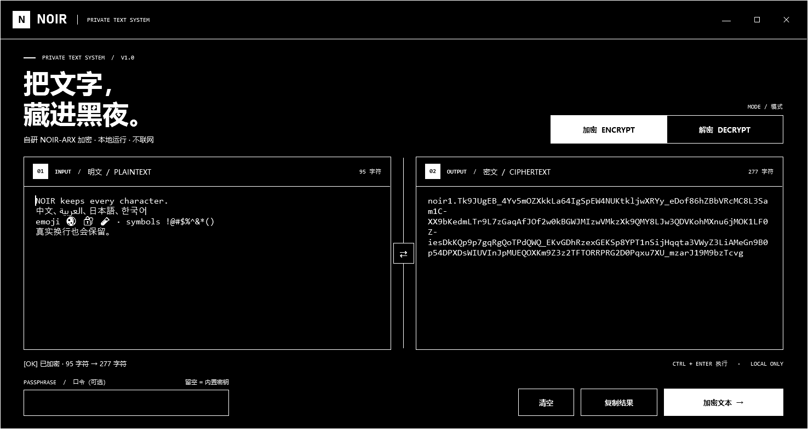

# NOIR

> 把文字，藏进黑夜。

**NOIR** 是一个运行在独立窗口里的纯黑白文本加密工具。它可以加密任意 Unicode 文本，也可以把 `noir1.` 开头的密文还原成原文。程序完全在本地运行，不联网，不保存历史。



---

## 快速开始

1. 双击 **`Noir.exe`**。
2. 默认处于「加密」模式：在左侧输入或粘贴文本，按 **加密文本 →**（或 `Ctrl + Enter`）。
3. 右侧出现以 `noir1.` 开头的密文，按 **复制结果**。
4. 需要还原时，切到「解密」，把密文粘贴到左侧，按 **解密文本 →**。

如果口令框留空，程序会使用内置密钥；填入口令则用该口令派生的密钥加密。解密时必须使用与加密时相同的口令。

> **注意：** 内置密钥适合“不想让人一眼看懂”的日常场景，但拿到本程序的人可以解开。真正的秘密请设置一个足够长的口令，并妥善保管。

### 运行环境

- Windows 10 / Windows 11
- .NET Framework 4.8（Windows 10 1903 之后通常已自带）
- 无需安装，无需管理员权限，无需网络

---

## 功能

- 支持任意文本：英文、中文、日文、韩文、阿拉伯文、符号、空格、制表符、换行、emoji 等。
- 每次加密都会生成新的随机盐和 nonce，相同明文每次的密文都不同。
- 加密后附带完整性校验：口令错误或密文被改动，会直接拒绝解密，不会输出乱码。
- 界面只用黑色和白色，无彩色、无圆角、无图片装饰。
- 可调整窗口大小、最大化；使用自绘标题栏。
- 双击标题栏最大化 / 还原，拖动标题栏移动窗口。
- 口令可留空；口令不会被写入磁盘。
- 所有计算都在本机完成。

---

## 界面与操作

| 区域 | 说明 |
| --- | --- |
| `加密 / ENCRYPT` | 明文 → 密文 |
| `解密 / DECRYPT` | 密文 → 明文 |
| `01 INPUT` | 输入区。加密时放明文，解密时放密文 |
| `02 OUTPUT` | 结果区，只读，可选中复制 |
| `⇄` | 把当前结果移到输入区，并自动切换加密/解密模式 |
| `PASSPHRASE / 口令（可选）` | 留空使用内置密钥；建议为敏感内容设置口令 |
| `清空` | 清空输入、输出和口令 |
| `复制结果` | 把输出复制到剪贴板 |
| 底部状态行 | 显示就绪、处理中、成功或错误信息 |

### 快捷键

| 快捷键 | 动作 |
| --- | --- |
| `Ctrl + Enter` | 执行当前加密 / 解密 |
| `Ctrl + Shift + C` | 复制输出 |
| `Ctrl + Shift + S` | 把结果移到输入并切换模式 |
| `Ctrl + Shift + X` | 清空全部 |
| `Ctrl + C / Ctrl + V` | 在文本框内正常复制 / 粘贴 |
| `Alt + F4` | 关闭 |

---

## 密文格式

NOIR 的输出是一行可复制文本：

```text
noir1.<Base64URL>
```

去掉前缀后，Base64URL 解码得到的二进制格式如下：

| 字段 | 长度 | 说明 |
| --- | ---: | --- |
| Magic | 4 字节 | ASCII `NOIR` |
| Version | 1 字节 | 当前为 `0x01` |
| Suite | 1 字节 | 当前为 `0x01`，表示 NOIR-ARX-512 |
| Salt | 16 字节 | 随机盐，用于 PBKDF2 |
| Nonce | 16 字节 | 随机 nonce，用于密钥流 |
| Tag | 16 字节 | HMAC-SHA256 截断到 128 位 |
| Ciphertext | N 字节 | 明文的 UTF-8 字节异或密钥流 |

前缀之后的 Base64URL 不含 `=` 填充。密文粘贴时允许换行和空格，程序会自动忽略这些空白字符；前缀大小写不敏感。

固定开销为 54 字节，因此即使明文为空，密文也至少有 78 个字符左右。

---

## 设计说明：NOIR-ARX

NOIR 的密码设计由自定义 ARX 密钥流与标准 KDF/MAC 组合而成：

### 1. 密钥派生

```text
secret = empty(passphrase)
    ? "NOIR-BUILTIN-V1-..."
    : "NOIR-PASSPHRASE-V1\0" + NFKC(passphrase)

salt   = 16 random bytes
master = PBKDF2-HMAC-SHA256(secret, salt, 180000 iterations, 32 bytes)
K_enc  = HMAC-SHA256(master, "NOIR/v1/encryption-key")
K_mac  = HMAC-SHA256(master, "NOIR/v1/authentication-key")
```

- PBKDF2 迭代 180,000 次，增加暴力猜测口令的成本。
- 加密密钥和认证密钥通过不同的 HMAC 标签做域分离，互不复用。
- 口令仅存在于当前进程内存中，不写入磁盘。
- 口令会做 Unicode NFKC 归一化；视觉等价的字符会归一到同一形式。

### 2. 密钥流：NOIR-ARX-512

- 状态为 16 个 32 位字，总计 512 位。
- 初始化：2 个常量字、4 个 nonce 字、8 个密钥字、2 个字的分组计数器。
- 共 12 轮。每轮对 4 组列分别执行自定义 ARX 混合：

```text
a += b;              d = rotl(d ^ a,  7);
c += d;              b = rotl(b ^ c, 11);
a += b;              d = rotl(d ^ a, 19);
c += d;              b = rotl(b ^ c, 23);
```

- 随后旋转 4 行、加入轮常量，再进行下一轮。
- 输出前与初始状态相加（feed-forward），每个分组输出 64 字节密钥流。
- 每处理一个 64 字节分组，分组计数器加一。
- 加密与解密都是同一个异或操作，因此完全可逆。

### 3. 认证与封装

采用 **encrypt-then-MAC**：

```text
T = HMAC-SHA256(K_mac, header || ciphertext)
T = T[0..15]
payload = header || T || ciphertext
armor   = "noir1." + Base64URL(payload)
```

MAC 覆盖版本、套件、盐、nonce 和全部密文。校验使用常量时间比较。任何一位被修改，解密都会失败。

### 4. 随机性

- 每次加密重新生成 16 字节 salt 和 16 字节 nonce。
- 即使明文和口令完全相同，两次输出的密文也不同。
- 随机数来自 Windows `RandomNumberGenerator`（CSPRNG）。

---

## 安全边界

这是一个**个人项目 / 课程设计风格的自定义密码实现**，不是经过密码学审计的生产级加密库。

- 内置密钥是公开写在源码中的：留空口令时，它提供的是“防窥”和“看不懂”，不是强保密。
- 需要真正保密时，请设置高熵口令；口令丢失后无法恢复明文。
- 自定义 ARX 算法没有经过公开密码分析。面对有动机的攻击者，请优先使用经过审计的 AES-256-GCM、XChaCha20-Poly1305 或 libsodium 等方案。
- 密文长度约为明文 UTF-8 长度的 1.33 倍再加固定开销，因此会泄露大致长度。
- 程序不联网、不落盘；但明文、口令和结果仍可能留在进程内存、页面文件、剪贴板和截屏工具中。
- 复制敏感内容到剪贴板后，记得及时覆盖或清空剪贴板。
- 不要把本程序用于生命攸关、金融或国家秘密级别的场景。

---

## 构建

项目自带已经编译好的 `Noir.exe`，普通使用不需要构建。

重新构建需要 Windows 和 .NET Framework 4.8：

```powershell
powershell -NoProfile -ExecutionPolicy Bypass -File .\build.ps1 -Test
```

构建脚本会调用 Windows 自带的 C# 编译器（`csc.exe`），从 GAC 引用 WPF 程序集。不需要 .NET SDK、NuGet 或网络连接。

只构建、不测试：

```powershell
powershell -NoProfile -ExecutionPolicy Bypass -File .\build.ps1
```

### 自测

`tests\NoirTests.exe` 会检查：

- 空文本、ASCII、换行、制表符、控制字符
- 中文、日文、韩文、阿拉伯文、希伯来文
- emoji、组合字符、Unicode 标点
- 5000 个随机 Unicode 标量
- 随机密文唯一性、错误口令拒绝、篡改和截断拒绝
- 自动忽略密文中的换行与空格
- 1 MiB 文本往返

最近一次结果：`PASS: 59 checks completed.`

---

## 文件结构

```text
NOIR/
├─ Noir.exe                 # 可直接运行的 Windows 独立窗口程序
├─ README.md
├─ build.ps1                # 使用 Windows 自带 csc 构建
├─ assets/
│  ├─ noir.ico              # 纯黑白应用图标
│  └─ screenshot.png        # 界面截图
├─ src/
│  ├─ NoirApp.cs            # WPF 界面与交互
│  ├─ NoirCipher.cs         # NOIR-ARX 算法与密文格式
│  ├─ NoirSelfTest.cs       # 自测入口
│  ├─ AssemblyInfo.cs       # 程序集信息
│  └─ app.manifest          # DPI 感知与 Windows 兼容性声明
└─ tests/
   └─ NoirTests.exe         # 自测程序（可选）
```

`Noir.exe` 已经嵌入图标和 manifest，不依赖 `assets` 目录；可以把 exe 单独复制到别处运行。

---

## 项目名字

**NOIR** 取自 film noir（黑色电影）：黑、白、克制、神秘。只有四个字母，简短、易记，也和程序的黑白界面一致。

---

## 版本

- Version: 1.0.0
- Cipher: NOIR-ARX-512 / v1
- UI: WPF, pure black & white
